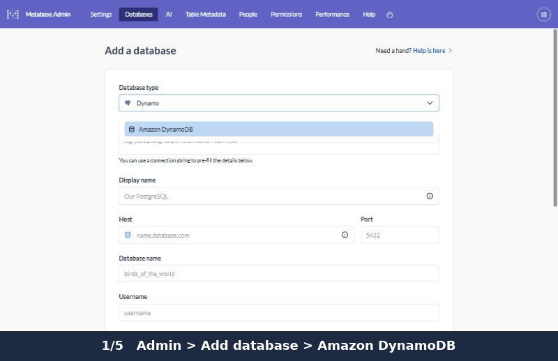

# Amazon DynamoDB driver for Metabase

Query and chart your DynamoDB tables in self-hosted Metabase: the visual query builder, filters, grouping by day/month,
sums and counts, dashboards, and plain SQL — no Athena, no ETL pipeline, no extra AWS services.

Answers the long-standing request [metabase/metabase#3368](https://github.com/metabase/metabase/issues/3368).



## Install

1. Download `dynamodb.metabase-driver.jar` from the [latest release](https://github.com/korolserhii/metabase-dynamodb-driver/releases/latest).
2. Put it in the `plugins/` directory next to `metabase.jar` (Docker: mount it to `/plugins`).
3. Restart Metabase.
4. **Admin → Databases → Add database → Amazon DynamoDB.**

**Docker:** put the jar in a folder on the host and mount that folder as `/plugins`:

```sh
mkdir -p ~/metabase-plugins
curl -L -o ~/metabase-plugins/dynamodb.metabase-driver.jar \
  https://github.com/korolserhii/metabase-dynamodb-driver/releases/latest/download/dynamodb.metabase-driver.jar
docker run -d -p 3000:3000 --name metabase -v ~/metabase-plugins:/plugins metabase/metabase
```

The official image reads drivers from `/plugins` (`MB_PLUGINS_DIR`). If the folder already has other drivers, keep
them there: the mount replaces the whole directory.

Tested with Metabase **v0.65.3.3** (automated end-to-end tests against DynamoDB Local). Metabase Cloud does not allow community drivers, so this works with self-hosted
Metabase only.

## Connecting

| Field | What to enter |
|---|---|
| AWS region | e.g. `eu-central-1` |
| Access key ID / Secret access key | An IAM user's key. Leave both empty to use the Metabase host's IAM role or environment credentials. |
| Custom endpoint URL (advanced) | Only for DynamoDB Local or a VPC endpoint. |
| Maximum rows read per table (advanced) | Default 100,000. |
| Maximum MB read per table (advanced) | Default 100. Whichever limit is reached first stops the read. |
| Re-read tables after, minutes (advanced) | Default 10. |
| Maximum read units per second (advanced) | Empty: half of a provisioned table's read capacity, or 200 for on-demand tables. A refresh is paced to this rate, so it leaves most of a provisioned table's capacity to your application. This limits how fast the driver reads; it is not a cap on your AWS bill and not a guarantee against throttling. |

The IAM identity needs only read permissions. `ListTables` cannot be limited to specific tables; `DescribeTable` and
`Scan` can, so list only the tables Metabase should see:

```json
{
  "Version": "2012-10-17",
  "Statement": [
    {
      "Effect": "Allow",
      "Action": "dynamodb:ListTables",
      "Resource": "*"
    },
    {
      "Effect": "Allow",
      "Action": ["dynamodb:DescribeTable", "dynamodb:Scan"],
      "Resource": [
        "arn:aws:dynamodb:eu-central-1:123456789012:table/Orders",
        "arn:aws:dynamodb:eu-central-1:123456789012:table/customer-events"
      ]
    }
  ]
}
```

Tables listed but not readable will fail to sync; everything else keeps working.

## How it works

DynamoDB cannot group, join or aggregate, so the driver reads each table (a `Scan`) into a private in-memory copy
inside Metabase and runs Metabase's queries against that copy. The copy is refreshed when it is older than the
refresh interval.

What this means for you:

- **The query builder works**: filters, summaries, breakouts by date.
- **SQL works** too. Quote table and attribute names exactly as in DynamoDB: `SELECT "status", COUNT(*) FROM "Orders" GROUP BY "status"`.
- **Read-only.** Nothing is ever written to DynamoDB.
- **Scans cost read capacity.** A table is scanned once per refresh interval, not once per query, and the scan is
  paced (see "Maximum read units per second"). Pacing limits how fast the driver reads, not what the scan costs: a
  refresh still reads the whole table (up to the limits below), about half a read unit per 4 KB.
- **Filters do not reduce reads.** Each refresh reads the whole table (up to the limits below); filters and date ranges
  are applied afterwards to the copy. A report on "last 7 days" still scans the table once per refresh interval.
- **Large tables**: reading stops at "Maximum rows read per table" (100,000) or "Maximum MB read per table" (100 MB),
  whichever comes first; the Metabase log says when a table was cut off and why.
- **Memory**: the copy lives in Metabase's own memory (JVM heap) and takes several times the raw data size, and every
  table counts. A rough rule: keep the sum of table limits below a third of the heap. If Metabase becomes slow or runs
  out of memory, lower the limits.

### Types

| DynamoDB | Metabase |
|---|---|
| Number (all whole numbers of up to 18 digits) | Big integer |
| Number (with decimals, or longer whole numbers) | Float (exact decimal) |
| String | Text |
| String with ISO dates (`2026-03-01`) | Date |
| String with ISO timestamps (`2026-03-01T10:00:00Z`) | Timestamp with time zone |
| Boolean | Boolean |
| Map, List, String/Number/Binary set | JSON text |

Items may have different attributes; every attribute that appears in a table becomes a column, empty where an item
does not have it.

## Pro

The driver in this repository — the **Community Edition** — is free and open source under Apache 2.0, with no limit
on how many Metabase instances use it. **Pro** is a separate commercial edition for teams whose tables outgrow it.
Pro is **not released yet**: it is in early access, and the first trial users decide what ships first.

| | Community (free) | Pro (planned) |
|---|---|---|
| Table size | up to 100,000 items / 100 MB per table | millions of items: copy on disk instead of Metabase memory, parallel reads |
| Read cost | paced reads (half of provisioned capacity by default) | hourly and daily read budgets, incremental refresh |
| Security | IAM keys or host role | hide or mask attributes; AssumeRole for other AWS accounts |
| New Metabase versions | automatic compatibility updates | guaranteed compatibility and email support |

**Planned price:** $299 per year for one production Metabase deployment (any number of replicas or containers);
test, staging and development instances are included at no extra cost. **Early access (free 30-day trial when Pro is ready):**
[request it here](https://github.com/korolserhii/metabase-dynamodb-driver/issues/new?template=pro-trial.yml) — tell us
your table sizes and what you need, and you get the build as soon as it is ready.
The Pro terms will be a separate commercial license; they never change the Apache 2.0 license of this repository.

## Building from source

The CI workflow in `.github/workflows/build.yml` is the reference: it checks out Metabase, places this repository at
`modules/drivers/dynamodb`, and runs `./bin/build-driver.sh dynamodb`. It then starts Metabase with the jar against
DynamoDB Local and runs the checks in `test/e2e/e2e.py`.

## License

Apache License 2.0.
