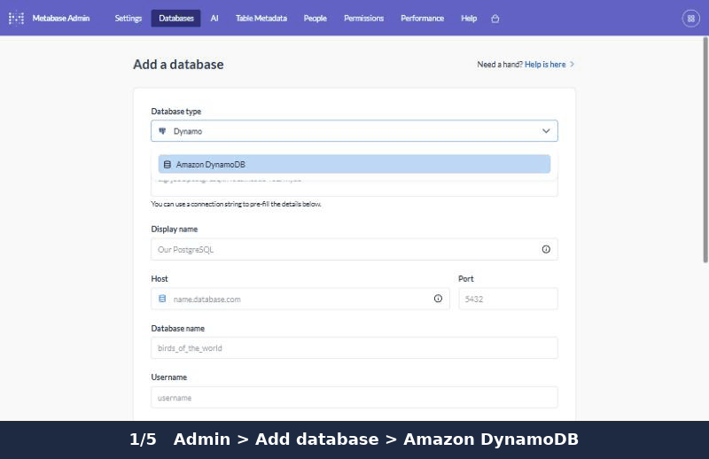

# Amazon DynamoDB driver for Metabase

Query and chart your DynamoDB tables in self-hosted Metabase: the visual query builder, filters, grouping by day/month,
sums and counts, dashboards, and plain SQL — no Athena, no ETL pipeline, no extra AWS services.

Answers the long-standing request [metabase/metabase#3368](https://github.com/metabase/metabase/issues/3368).



## Install

1. Download `dynamodb.metabase-driver.jar` from the [latest release](https://github.com/korolserhii/metabase-dynamodb-driver/releases/latest).
2. Put it in the `plugins/` directory next to `metabase.jar` (Docker: mount it to `/plugins`).
3. Restart Metabase.
4. **Admin → Databases → Add database → Amazon DynamoDB.**

Tested with Metabase **v0.65.2.5** (automated end-to-end tests against DynamoDB Local). Metabase Cloud does not allow community drivers, so this works with self-hosted
Metabase only.

## Connecting

| Field | What to enter |
|---|---|
| AWS region | e.g. `eu-central-1` |
| Access key ID / Secret access key | An IAM user's key. Leave both empty to use the Metabase host's IAM role or environment credentials. |
| Custom endpoint URL (advanced) | Only for DynamoDB Local or a VPC endpoint. |
| Maximum rows read per table (advanced) | Default 100,000. |
| Re-read tables after, minutes (advanced) | Default 10. |

The IAM identity needs only read permissions. `ListTables` cannot be limited to specific tables; `DescribeTable` and
`Scan` can, so list only the tables Metabase should see:

```json
{
  "Version": "2012-10-17",
  "Statement": [
    {
      "Effect": "Allow",
      "Action": "dynamodb:ListTables",
      "Resource": "*"
    },
    {
      "Effect": "Allow",
      "Action": ["dynamodb:DescribeTable", "dynamodb:Scan"],
      "Resource": [
        "arn:aws:dynamodb:eu-central-1:123456789012:table/Orders",
        "arn:aws:dynamodb:eu-central-1:123456789012:table/customer-events"
      ]
    }
  ]
}
```

Tables listed but not readable will fail to sync; everything else keeps working.

## How it works

DynamoDB cannot group, join or aggregate, so the driver reads each table (a `Scan`) into a private in-memory copy
inside Metabase and runs Metabase's queries against that copy. The copy is refreshed when it is older than the
refresh interval.

What this means for you:

- **The query builder works**: filters, summaries, breakouts by date.
- **SQL works** too. Quote table and attribute names exactly as in DynamoDB: `SELECT "status", COUNT(*) FROM "Orders" GROUP BY "status"`.
- **Read-only.** Nothing is ever written to DynamoDB.
- **Scans cost read capacity.** A table is scanned once per refresh interval, not once per query.
- **Large tables**: only the first *N* items are read (the "Maximum rows read per table" setting); the Metabase log says
  when a table was cut off. The copy is held in Metabase's memory, so size the JVM heap accordingly.

### Types

| DynamoDB | Metabase |
|---|---|
| Number (all whole numbers of up to 18 digits) | Big integer |
| Number (with decimals, or longer whole numbers) | Float (exact decimal) |
| String | Text |
| String with ISO dates (`2026-03-01`) | Date |
| String with ISO timestamps (`2026-03-01T10:00:00Z`) | Timestamp with time zone |
| Boolean | Boolean |
| Map, List, String/Number/Binary set | JSON text |

Items may have different attributes; every attribute that appears in a table becomes a column, empty where an item
does not have it.

## Building from source

The CI workflow in `.github/workflows/build.yml` is the reference: it checks out Metabase, places this repository at
`modules/drivers/dynamodb`, and runs `./bin/build-driver.sh dynamodb`. It then starts Metabase with the jar against
DynamoDB Local and runs the checks in `test/e2e/e2e.py`.

## License

Apache License 2.0.
